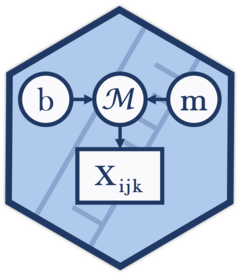

```{r}
#| include: false
library(bmm)
library(brms)  # fixef(), hypothesis(): not re-exported by bmm
library(tidyverse)
library(tidybayes)
source(here::here("_common.R"))  # wk_colors + theme_workshop()

dat <- read.csv(here::here("data", "sdt_recognition.csv"))
fit_sdt <- readRDS(here::here("models", "sdt_yn.rds"))
fit_rating <- readRDS(here::here("models", "sdt_rating.rds"))

# Proportions without the leading zero (APA style): 0.742 -> ".74"
fmt_prop <- function(x) sub("^0\\.", ".", sprintf("%.2f", x))
# Three decimals, never rounded up to 1: .9995 -> "> .999"
fmt_prop3 <- function(x) {
  if (x > 0.999) "> .999" else sub("^0\\.", ".", sprintf("%.3f", x))
}

item_colors <- c("new items" = wk_colors[["grey"]],
                 "old items" = wk_colors[["blue"]])

# Evidence-axis plots: no grid, no y axis, just the x axis (slides 10, 11, 26)
theme_sdt_axis <- function() {
  theme(panel.grid = element_blank(),
        axis.text.y = element_blank(),
        axis.line.x = element_line(colour = "grey40"))
}
```

## Part 1: The bmm Workflow & Signal Detection Theory {.section-divider}

Gidon T. Frischkorn · University of Zurich

First: why model the cognitive process at all?

<!--
Timing (target ~25 min talk; 30 min hard cap; leave room for questions):
  min 8: reach SDT divider | min 12: hands-up beat | min 15: Specify
  min 17: live IDE beat | min 22: Evaluate (+0:30 for the predictive
  check) | min 25: FLEX go/no-go

Two interactive beats, both rehearsed, both with static insurance in the deck:
  - "Why is accuracy lower?": two shows of hands before the reveal (~0:40)
  - "Specify: one formula per parameter": live in the IDE. Type bmf(), break
    it with `dprime`, fix it with parameter_info() (~2:15). The next slide shows
    the same error and fix, so the demo can be dropped at any point.

Cut ladder: (1) rating FLEX section -1:00 (if cut, say one sentence on the
            take-home slide: with confidence ratings the equal-variance
            assumption fails and the d' difference becomes uncertain); (2) live IDE beat, keep the static
            "A common first error" slide -2:15; (3) drop latent_sdt slide -0:45;
            (4) merge t-test slide into question slide -0:45
Never cut the hands-up beat. It costs 40 s, and it is what makes the
false-alarm reveal land.

Figure builds: a figure that builds up in steps is an .r-stack with one chunk
per step. Every step draws the same plot with fixed coordinates and adds (or
unhides) layers, so the stacked PNGs line up and only the new elements appear.
The PNGs are opaque, so each step covers the one below it.
-->

## The model you already use {.smaller}

Regression, *t*-test, and ANOVA are the same model:

::: {.formula-box}
$$y \sim \text{Normal}(\mu, \sigma) \qquad\qquad \mu = \beta_0 + \beta_1 X$$
:::

:::: {.columns}

::: {.column .fragment width="50%"}
```{r}
#| echo: false
#| fig-height: 3.6
#| fig-alt: "Scatterplot of a continuous predictor against an outcome with a fitted regression line."
set.seed(42)
sim_cont <- tibble(x = runif(40, 0, 10)) |>
  mutate(y = 2 + 0.6 * x + rnorm(40, 0, 1.2))

ggplot(sim_cont, aes(x, y)) +
  geom_point(size = 3, alpha = 0.7, color = wk_colors[["blue"]]) +
  geom_smooth(method = "lm", se = FALSE, linewidth = 1.5,
              color = wk_colors[["orange"]]) +
  labs(x = "X (continuous)", y = "y", title = "Regression") +
  theme_workshop()
```
:::

::: {.column .fragment width="50%"}
```{r}
#| echo: false
#| fig-height: 3.6
#| fig-alt: "Jittered points for two groups with the group means marked by horizontal lines."
set.seed(42)
sim_cat <- tibble(x = rep(c("A", "B"), each = 20)) |>
  mutate(y = 5 + (x == "B") * 1.5 + rnorm(40, 0, 1.2))
sim_cat_means <- summarise(sim_cat, y = mean(y), .by = x)

ggplot(sim_cat, aes(x, y)) +
  geom_jitter(width = 0.08, size = 3, alpha = 0.7, color = wk_colors[["blue"]]) +
  geom_crossbar(data = sim_cat_means, aes(ymin = y, ymax = y),
                width = 0.4, linewidth = 1, color = wk_colors[["orange"]]) +
  labs(x = "X (categorical)", y = "y", title = "t-test / ANOVA") +
  theme_workshop()
```
:::

::::

::: {.notes}
Most of you fit this model all the time without calling it a model. Both
panels use the same formula; only the type of predictor differs. The rest of
the talk builds on this.
:::

## Closer to the data: model the trials {.smaller}

Means look Gaussian. Single trials do not, so we pick a distribution that fits
the data type:

:::: {.columns}

::: {.column .fragment width="50%"}
```{r}
#| echo: false
#| fig-height: 3
#| fig-alt: "Bar chart of a binomial probability mass function for 20 trials with success probability 0.75."
binom_pmf <- tibble(k = 0:20, p = dbinom(k, 20, 0.75))

ggplot(binom_pmf, aes(k, p)) +
  geom_col(fill = wk_colors[["blue"]]) +
  labs(x = "correct out of 20 trials", y = NULL,
       title = "Accuracy: 0/1 outcomes") +
  theme_workshop()
```

::: {.formula-box}
**Binomial** · `probability correct ~ condition`
:::
:::

::: {.column .fragment width="50%"}
```{r}
#| echo: false
#| fig-height: 3
#| fig-alt: "Histogram of right-skewed single-trial response times with a lognormal density curve overlaid."
set.seed(42)
rt_trials <- tibble(rt = rlnorm(500, log(0.7), 0.5))
lnorm_curve <- tibble(rt = seq(0.1, 3, length.out = 300)) |>
  mutate(dens = dlnorm(rt, log(0.7), 0.5))

ggplot(rt_trials, aes(rt)) +
  geom_histogram(aes(y = after_stat(density)), bins = 40,
                 fill = wk_colors[["grey"]], color = "white") +
  geom_line(data = lnorm_curve, aes(rt, dens), linewidth = 1.3,
            color = wk_colors[["blue"]]) +
  labs(x = "RT (s)", y = NULL, title = "Response times: skewed") +
  theme_workshop()
```

::: {.formula-box}
**Lognormal** · `typical RT ~ condition`
:::
:::

::::

::: {.fragment}
A better description of the data. Still, a probability and a typical RT say
nothing about the process behind them.
:::

::: {.notes}
Why not stay with the t-test on means? Because the Gaussian describes the
means and nothing else: the same bell curve fits any process that could have
produced those means. Same move as before: the distribution changed, the
right-hand side did not. We still predict the parameters of a distribution
from predictors, in the formula language everyone knows. However, a
probability and a typical RT do not stand for any cognitive mechanism.
Nothing here is memory, bias, or processing speed.
:::

## From regression to cognitive models

::: {.formula-box}
**Normal** · `mean ~ condition`
:::

::: {.formula-box .fragment}
**Binomial** · `probability ~ condition`
:::

::: {.formula-box .fragment style="border-left: 6px solid #dc6800;"}
**Cognitive model** · `d' ~ condition` · `c ~ condition`
:::

::: {.fragment}
Only the distribution changes. We always **predict its parameters**.
:::

::: {.notes}
This slide is the main argument of the talk. A cognitive measurement model is
a distribution whose parameters have a psychological meaning: d' is memory
strength, c is response bias. If you can write mu ~ condition, you can write
d ~ condition. The formulas work exactly the way everyone already knows.
:::

## bmm {.smaller}

:::: {.columns}

::: {.column width="35%"}
{fig-alt="Hex logo of the bmm package" width="85%"}
:::

::: {.column width="65%"}
*Easy and Accessible Bayesian Measurement Models Using brms*

::: {.incremental}
- Parameters with **theoretical meaning**: $d'$, capacity, drift rate
- Every parameter takes an **R formula**
- **Hierarchical** estimation across participants, groups, and items
- Runs on brms and Stan, but **you don't write Stan code**
:::

[popov-lab.github.io/bmm](https://popov-lab.github.io/bmm/)
:::

::::

::: {.notes}
Say the motivation here: until recently, fitting these models meant writing
JAGS or Stan code by hand, and that kept measurement models out of most labs.
With bmm you pick the model and write the formula; brms and Stan do the rest.
I develop the package together with Ven Popov. The SDT models are on CRAN
since bmm 1.4.1 (October 2026); everything today runs on that release.
:::

## Today: one workflow, three models

:::: {.columns .model-boxes}

::: {.column width="33%"}
::: {.formula-box}
**Signal Detection**\
old/new responses\
[Gidon]{.speaker}
:::
:::

::: {.column width="33%"}
::: {.formula-box}
**M3**\
which option is chosen\
[Chenyu]{.speaker}
:::
:::

::: {.column width="33%"}
::: {.formula-box}
**EZ-DDM**\
choices and response times\
[Adriana]{.speaker}
:::
:::

::::

::: {.formula-box .fragment style="border-left: 6px solid #dc6800;"}
Each part follows the same steps: **specify → fit → evaluate**\
Look for this marker above the slide titles: [[specify]{.on} · fit · evaluate]{.track .inline}
:::

:::: {.columns .fragment}

::: {.column width="20%"}
{fig-alt="QR code linking to the workshop website" width="60%"}
:::

::: {.column width="80%"}
::: {.small}
Slides, notebooks, data, and readings are already online. **Scan the code
now, then put your phone away**: nothing today requires following along on a
screen.
:::
:::

::::

::: {.notes}
Roadmap: recognition memory now, the memory measurement model next, and
response times with the diffusion model last. By the third round the workflow
should feel routine, and that is the goal.

Say the phone line out loud. Give them ten seconds to scan, then tell them to
put the phone away. People reading the notebook on a laptop end up following
neither the notebook nor the talk. The same QR code is on the take-home
slide, so nobody misses anything.
:::

## Signal Detection Theory for recognition memory {.section-divider}

## Two distributions, one decision

```{r}
#| include: false
d <- 2
crit <- 1
sdt_curves <- expand_grid(
  item = c("new items", "old items"),
  x    = seq(-3.5, 5.5, length.out = 400)
) |>
  mutate(dens = dnorm(x, mean = ifelse(item == "old items", d, 0)))

# Four build steps of one figure. Fixed coordinates keep the panel identical
# across steps; the conditional layers keep their original drawing order.
sdt_plot <- function(show_d = FALSE, show_crit = FALSE, show_hits = FALSE) {
  shaded <- c(if (show_crit) "new items", if (show_hits) "old items")
  ggplot(sdt_curves, aes(x, dens)) +
    (if (length(shaded)) geom_area(data = ~ filter(.x, x >= crit, item %in% shaded),
                                   aes(fill = item), alpha = 0.45,
                                   position = "identity")) +
    geom_line(aes(color = item), linewidth = 1.5) +
    (if (show_crit) geom_vline(xintercept = crit, linewidth = 1.3,
                               color = wk_colors[["orange"]])) +
    (if (show_d) list(
      annotate("segment", x = 0, xend = d, y = 0.43, yend = 0.43,
               linewidth = 1, color = "black",
               arrow = arrow(ends = "both", length = unit(0.18, "cm"))),
      annotate("text", x = d / 2, y = 0.46, label = "d'", size = 7)
    )) +
    annotate("text", x = -1.6, y = 0.31, label = "new items",
             size = 6, color = wk_colors[["grey"]]) +
    annotate("text", x = 3.6, y = 0.31, label = "old items",
             size = 6, color = wk_colors[["blue"]]) +
    (if (show_crit) list(
      annotate("text", x = crit, y = 0.51, label = "criterion c",
               size = 6, hjust = 1.1, color = wk_colors[["orange"]]),
      annotate("text", x = 1.75, y = 0.035, label = "false alarms",
               size = 5, color = "grey25")
    )) +
    (if (show_hits) annotate("text", x = 2.75, y = 0.15, label = "hits",
                             size = 5, color = wk_colors[["blue"]])) +
    scale_fill_manual(values = item_colors, guide = "none") +
    scale_color_manual(values = item_colors, guide = "none") +
    coord_cartesian(xlim = c(-3.5, 5.5), ylim = c(0, 0.51)) +
    labs(x = "memory-strength evidence", y = NULL) +
    theme_workshop() +
    theme_sdt_axis()
}
```

:::: {.r-stack}

```{r}
#| label: sdt-dist
#| echo: false
#| fig-height: 4.3
#| fig-alt: "Two overlapping evidence distributions, one for new items and one for old items shifted to the right."
sdt_plot()
```

::: {.fragment fragment-index=1}
```{r}
#| label: sdt-dprime
#| echo: false
#| fig-height: 4.3
#| fig-alt: "The same two evidence distributions with a double-headed arrow between their means, labeled d-prime."
sdt_plot(show_d = TRUE)
```
:::

::: {.fragment fragment-index=2}
```{r}
#| label: sdt-crit
#| echo: false
#| fig-height: 4.3
#| fig-alt: "The two evidence distributions with d-prime marked and a criterion line; the new-item area right of the criterion is shaded and labeled false alarms."
sdt_plot(show_d = TRUE, show_crit = TRUE)
```
:::

::: {.fragment fragment-index=3}
```{r}
#| label: sdt-hits
#| echo: false
#| fig-height: 4.3
#| fig-alt: "The same figure with the old-item area right of the criterion shaded as well and labeled hits."
sdt_plot(show_d = TRUE, show_crit = TRUE, show_hits = TRUE)
```
:::

::::

::: {.fragment fragment-index=1}
- $d'$: separation of the two distributions
:::

::: {.fragment fragment-index=2}
- $c$: how much evidence it takes to say "old", counted from the new-item mean
:::

::: {.notes}
Four steps. First the two distributions: memory strength for new and for
old items. Click: d', the distance between them. Click: the criterion. Every
item to the right of it gets an "old" response, so the new items right of it
are false alarms. Click: the old items right of it are hits. Two numbers
describe the observer: separation and threshold. The threshold is measured
from the mean of the new-item distribution, which is where bmm puts it too:
c = 0 is a criterion right at the new-item mean. The next slide moves the
threshold.
:::

## Moving the criterion changes accuracy {.smaller}

Assume two people with the same memory strength ($d' = 2$) but different
criteria. $c$ counts from the new-item mean, so $c = d'/2 = 1$ sits halfway
between the distributions; a lower $c$ says "old" more readily:

```{r}
#| include: false
d <- 2
crit_people <- tibble(
  person = c("A", "B"),
  bias   = c("neutral", "liberal"),
  c      = c(1, 0)
) |>
  mutate(
    # bmm's criterion is measured from the mean of the new-item distribution
    location = c,
    hr  = 1 - pnorm(location, mean = d),
    far = 1 - pnorm(location, mean = 0),
    acc = (hr + (1 - far)) / 2,
    title = sprintf("Person %s: %s (c = %s)", person, bias,
                    sub("-", "−", sprintf("%g", c)))
  )

crit_plot <- function(who) {
  p <- filter(crit_people, person == who)
  ggplot(sdt_curves, aes(x, dens)) +
    geom_area(data = ~ filter(.x, x >= p$location), aes(fill = item),
              alpha = 0.4, position = "identity") +
    geom_line(aes(color = item), linewidth = 1.2) +
    geom_vline(xintercept = p$location, linewidth = 1.2,
               color = wk_colors[["orange"]]) +
    scale_fill_manual(values = item_colors, guide = "none") +
    scale_color_manual(values = item_colors, guide = "none") +
    labs(x = "memory-strength evidence", y = NULL, title = p$title) +
    theme_workshop() +
    theme_sdt_axis()
}

rate_line <- function(who) {
  p <- filter(crit_people, person == who)
  sprintf("Hits %s · False alarms %s · Accuracy **%s**",
          fmt_prop(p$hr), fmt_prop(p$far), fmt_prop(p$acc))
}
```

:::: {.columns}

::: {.column width="50%"}
::: {.fragment}
```{r}
#| label: crit-a
#| echo: false
#| fig-width: 5.5
#| fig-height: 4.4
#| fig-alt: "New-item and old-item evidence distributions with the criterion halfway between them; the areas right of the criterion are shaded."
crit_plot("A")
```
:::

::: {.fragment style="text-align: center;"}
`r rate_line("A")`
:::
:::

::: {.column width="50%"}
::: {.fragment}
```{r}
#| label: crit-b
#| echo: false
#| fig-width: 5.5
#| fig-height: 4.4
#| fig-alt: "The same two distributions with the criterion shifted left to the new-item mean; larger areas right of the criterion are shaded for both item types."
crit_plot("B")
```
:::

::: {.fragment style="text-align: center;"}
`r rate_line("B")`
:::
:::

::::

::: {.notes}
d' is 2 for both people, so their memory is identical. Person A has a
neutral criterion, halfway between the distributions (c = 1, half of d').
Person B has a liberal criterion (c = 0, right at the new-item mean): hits
and false alarms both go up, and accuracy drops. Everything an accuracy
analysis sees has changed, although memory has not. The real data will show
the same pattern.
:::

## The data: recognition memory {.smaller}

```{r}
#| include: false
n_per_cond <- dat |>
  distinct(pid, condition) |>
  count(condition) |>
  pull(n) |>
  unique()
stopifnot(length(n_per_cond) == 1)  # the slide says "each"
```

Data from Koen, Aly, Wang, and Yonelinas (2013):

```{r}
#| label: task-schematic
#| echo: false
#| fig-width: 11
#| fig-height: 2.3
#| fig-alt: "Task schematic. Study: a list of words. Test: one word at a time, old or new? Rate confidence from 1, sure new, to 6, sure old; ratings 4 to 6 count as old."
card <- function(x, y, word, w = 1.5, h = 0.6, fill = "white") {
  list(
    annotate("rect", xmin = x - w / 2, xmax = x + w / 2,
             ymin = y - h / 2, ymax = y + h / 2,
             fill = fill, colour = "grey40", linewidth = 0.6),
    annotate("text", x = x, y = y, label = word, size = 6, fontface = "bold")
  )
}
arrow_at <- function(x0, x1, y = 1.1) {
  annotate("segment", x = x0, xend = x1, y = y, yend = y,
           linewidth = 1, colour = wk_colors[["grey"]],
           arrow = arrow(length = unit(0.25, "cm"), type = "closed"))
}
scale_x <- 6.6 + 0:5 * 0.85
ggplot() +
  # 1. study: one card listing the words
  annotate("rect", xmin = 0.6, xmax = 2.2, ymin = 0.55, ymax = 1.95,
           fill = "white", colour = "grey40", linewidth = 0.6) +
  annotate("text", x = 1.4, y = c(1.6, 1.25, 0.9),
           label = c("table", "river", "candle"), size = 6,
           fontface = "bold") +
  # 2. test: one word, old or new?
  arrow_at(2.5, 3.2) +
  card(4.2, 1.1, "river", fill = wk_colors[["grey"]] |> alpha(0.15)) +
  # 3. confidence rating 1-6
  arrow_at(5.2, 5.9) +
  annotate("tile", x = scale_x, y = 1.1, width = 0.75, height = 0.6,
           fill = rep(c(wk_colors[["grey"]], wk_colors[["blue"]]), each = 3),
           alpha = 0.85) +
  annotate("text", x = scale_x, y = 1.1, label = 1:6, size = 6,
           colour = "white", fontface = "bold") +
  annotate("text", x = scale_x[c(1, 6)], y = 0.55,
           label = c("sure new", "sure old"), size = 5,
           colour = "grey30", fontface = "italic") +
  annotate("segment", x = scale_x[4] - 0.35, xend = scale_x[6] + 0.35,
           y = 1.6, yend = 1.6, linewidth = 1, colour = wk_colors[["blue"]]) +
  annotate("text", x = mean(scale_x[4:6]), y = 1.85,
           label = "4 to 6 counts as \"old\"", size = 5,
           colour = wk_colors[["blue"]], fontface = "bold") +
  # step headers
  annotate("text", x = c(1.4, 4.2, mean(scale_x)), y = 2.35,
           label = c("1  Study a word list", "2  Test: old or new?",
                     "3  How sure?"),
           size = 6, fontface = "bold", colour = "grey20") +
  coord_cartesian(xlim = c(0, 11.3), ylim = c(0.35, 2.5), expand = FALSE) +
  theme_void()
```

::: {.incremental}
- **Two groups** of `r n_per_cond` people, tested differently:
  **full attention** (no second task during the test) and **immediate** (test
  right after study)
- **One row per trial:** who, which group, old or new word, the response
:::

::: {.fragment}
```{r}
#| echo: false
head(dat, 3) |> knitr::kable()
```
:::

::: {.notes}
Walk the drawing left to right: study a list, then one test word at a time,
old or new, with a confidence rating; 4 to 6 counts as "old". The three
words are made up for the drawing, not items from the study.

The data are the `roc6` dataset of the MPTinR package: the control groups of
two experiments of the paper, Exp. 2 (full attention at test) and Exp. 4
(immediate test), 48 people each, `r format(nrow(dat), big.mark = ",")`
trials in total. The codebook is data/README.md. Same data as the Vuorre
(2025) tutorial in resources/01_sdt, which uses only the full-attention
condition, so attendees can read the paper and the notebook side by side. The
binary response is say_old = rating >= 4, following Koen et al.'s own first
analysis.

If someone asks: the two conditions come from two experiments of the same
paper, so the contrast is a demonstration, not a clean manipulation.
:::

## See the data before any model

```{r}
#| include: false
pp_rates <- dat |>
  summarise(p_yes = mean(say_old), .by = c(pid, condition, stimulus)) |>
  pivot_wider(names_from = stimulus, values_from = p_yes)

# Both steps plot all points; step 1 hides the immediate group via alpha, so
# axes and legend stay identical.
rates_plot <- function(show_imm = FALSE) {
  ggplot(pp_rates, aes(new, old, color = condition, alpha = condition)) +
    geom_abline(linetype = "dashed", color = wk_colors[["grey"]]) +
    annotate("text", x = 0.86, y = 0.8, label = "chance", angle = 45,
             size = 5, color = wk_colors[["grey"]]) +
    geom_point(size = 3) +
    scale_color_manual(
      values = c(full_attention = wk_colors[["blue"]],
                 immediate = wk_colors[["orange"]]),
      labels = c(full_attention = "full attention", immediate = "immediate")
    ) +
    scale_alpha_manual(values = c(full_attention = 0.8,
                                  immediate = if (show_imm) 0.8 else 0),
                       guide = "none") +
    guides(color = guide_legend(override.aes = list(alpha = 0.8))) +
    coord_equal(xlim = c(0, 1), ylim = c(0, 1)) +
    labs(x = "False-alarm rate", y = "Hit rate", color = NULL) +
    theme_workshop()
}
```

:::: {.r-stack}

```{r}
#| label: rates-full
#| echo: false
#| fig-height: 5
#| fig-alt: "Scatterplot of false-alarm rate against hit rate for participants in the full-attention condition, with the chance diagonal as a dashed line."
rates_plot()
```

::: {.fragment}
```{r}
#| label: rates-both
#| echo: false
#| fig-height: 5
#| fig-alt: "Scatterplot of false-alarm rate against hit rate per participant, colored by condition, with the chance diagonal as a dashed line."
rates_plot(show_imm = TRUE)
```
:::

::::

::: {.notes}
On entry: the full-attention group only. One point is one person. Everyone sits above the dashed
diagonal, so every participant has d' > 0. Click: the immediate group. The
orange cloud sits further to the right, which means more false alarms. The
model answers two questions, for each person and each group: how sensitive,
and how biased.
:::

## The standard analysis: proportion correct {.smaller}

Proportion correct per participant, tested with the Gaussian model from the
start of the session:

:::: {.columns}

::: {.column width="55%"}
```{r}
#| code-line-numbers: "1-3|5"
#| results: hide
acc <- dat |>
  summarise(pc  = mean(say_old == is_old),
            .by = c(pid, condition))

t.test(pc ~ condition, data = acc)
```

```{r}
#| include: false
tt <- t.test(pc ~ condition, data = acc)
tt_p <- if (tt$p.value < .001) "< .001" else sub("^0", "", sprintf("= %.3f", tt$p.value))
tt_diff <- 100 * abs(diff(tt$estimate))
```

::: {.fragment}
**Result:** *t*(`r sprintf("%.1f", tt$parameter)`) =
`r sprintf("%.2f", tt$statistic)`, *p* `r tt_p`. The immediate group scores
`r sprintf("%.0f", tt_diff)` percentage points lower.
:::
:::

::: {.column .fragment width="45%"}
```{r}
#| echo: false
#| fig-height: 4.5
#| fig-alt: "Jittered per-participant proportion correct for both conditions with group means and 95 percent confidence intervals; the immediate group is clearly lower."
acc_sum <- acc |>
  summarise(m = mean(pc), se = sd(pc) / sqrt(n()), .by = condition)

ggplot(acc, aes(condition, pc, color = condition)) +
  geom_jitter(width = 0.08, size = 2.5, alpha = 0.5) +
  geom_pointrange(data = acc_sum,
                  aes(y = m, ymin = m - 1.96 * se, ymax = m + 1.96 * se),
                  color = "black", linewidth = 1.1, size = 0.7) +
  scale_color_manual(values = unname(wk_colors[c("blue", "orange")]),
                     guide = "none") +
  scale_x_discrete(labels = c("full attention", "immediate")) +
  labs(x = NULL, y = "Proportion correct") +
  theme_workshop()
```
:::

::::

::: {.notes}
A standard analysis with a standard result: about five percentage points
lower accuracy in the immediate group, t around 4. This is the Gaussian model
on a summary score from the start of the talk, and it is fine as far as it
goes. The difference is significant. The next slide asks what it means.
:::

## Why is accuracy lower? {.question-slide}

```{r}
#| include: false
rates <- dat |>
  summarise(p_yes = mean(say_old), .by = c(pid, condition, is_old)) |>
  summarise(rate = mean(p_yes), .by = c(condition, is_old)) |>
  mutate(
    condition = recode(condition, full_attention = "full attention"),
    measure = factor(ifelse(is_old == 1, "hit rate", "false-alarm rate"),
                     levels = c("false-alarm rate", "hit rate"))
  )

fa <- filter(rates, is_old == 0)
hits <- filter(rates, is_old == 1)

# Both steps draw everything; step 1 hides the false-alarm row via alpha, so
# the axes do not move between steps.
dumbbell_plot <- function(show_fa = FALSE) {
  fa_alpha <- if (show_fa) 1 else 0
  ggplot(rates, aes(rate, measure)) +
    geom_line(aes(group = measure, alpha = measure), linewidth = 1.2,
              color = wk_colors[["grey"]]) +
    geom_point(aes(color = condition, alpha = measure), size = 6) +
    geom_text(data = hits,
              aes(label = condition, color = condition,
                  hjust = ifelse(condition == "immediate", -0.25, 1.25)),
              size = 5.5, fontface = "bold") +
    annotate("text", x = mean(fa$rate), y = 0.6,
             label = "false alarms differ most",
             size = 5, color = wk_colors[["orange"]], alpha = fa_alpha) +
    scale_color_manual(values = c("full attention" = wk_colors[["blue"]],
                                  immediate = wk_colors[["orange"]]),
                       guide = "none") +
    scale_alpha_manual(values = c("false-alarm rate" = fa_alpha,
                                  "hit rate" = 1),
                       guide = "none") +
    scale_x_continuous(limits = c(0, 1)) +
    labs(x = "Proportion \"old\" responses", y = NULL) +
    theme_workshop() +
    theme(plot.background = element_rect(fill = "white", color = NA))
}
```

::: {.fragment}
**Hands up:** Did the immediate group *remember less*, or did they *say "old"
more often*?
:::

:::: {.r-stack}

::: {.fragment}
```{r}
#| label: dumbbell-hits
#| echo: false
#| fig-height: 3.4
#| fig-alt: "Hit rates of the two conditions on one row: the two points nearly coincide."
dumbbell_plot()
```
:::

::: {.fragment}
```{r}
#| label: dumbbell-fa
#| echo: false
#| fig-height: 3.4
#| fig-alt: "Dumbbell chart comparing the two conditions on hit rate and false-alarm rate: the hit-rate points nearly coincide while the false-alarm points sit far apart."
dumbbell_plot(show_fa = TRUE)
```
:::

::::

::: {.fragment}
Worse memory, a more liberal criterion, or both? **Proportion correct cannot
tell them apart.**
:::

::: {.notes}
*** PREDICT-BEFORE-REVEAL (~40 s). Reveal the question, then actually ask for
two shows of hands and WAIT. Count them out loud and name the split ("okay,
mostly memory, a few of you on bias"). Only then reveal the hit rates, and
then the false alarms. Everyone in the room has now committed to an answer,
so the data meets a prediction. Do not skip the waiting. ***

Hit rates are practically identical; the immediate group is even slightly
higher. The whole accuracy drop comes from false alarms. A criterion shift
did exactly this on the "Moving the criterion" slide: bias moves hits and
false alarms together, and here it hides whatever happened to memory.
Neither show of hands was wrong. Proportion correct simply cannot separate
the two explanations. For that we need the model, which is what bmm is for.
:::

## Specify, fit, evaluate with bmm {.section-divider}
[[specify]{.on} · [fit]{.on} · [evaluate]{.on}]{.track}

The same three steps come back for the M3 and the DDM.

## Choose the model {.smaller}
[[specify]{.on} · fit · evaluate]{.track}

`sdt_yn()` needs counts per participant and stimulus type. One `summarise()`
gets us there:

```{r}
#| results: hold
#| code-line-numbers: "1-5|7-8"
binary_counts <- dat |>
  summarise(n_old    = sum(say_old),
            n_trials = n(),
            .by = c(pid, condition, is_old))
head(binary_counts, 2)

sdt_model <- sdt_yn(response = "n_old", stimulus = "is_old",
                    n_trials = "n_trials")
```

::: {.notes}
The model object knows its parameters (d, criterion, and sdratio, which is
fixed at 0: the equal-variance assumption), its data requirements, and its
default priors. Printing it in the console shows all three; the live demo on
the next slide does that.

Say it here, because someone will notice that we just aggregated after
criticizing aggregation: we keep the number of trials next to every count.
A proportion correct in a t-test is treated as a noise-free value. The count
with its n_trials goes into a binomial likelihood, so the model knows that
88 out of 100 is less certain than 880 out of 1000, and that uncertainty
travels through to d', c, and every test.
:::

## One formula per parameter {.smaller}
[[specify]{.on} · fit · evaluate]{.track}

Each formula names a **model parameter** and says how it varies across
conditions and participants:

```{r}
#| eval: false
#| code-line-numbers: "3|4|2-5"
fit_sdt <- bmm(
  formula = bmf(
    d         ~ 1 + condition + (1 | pid),
    criterion ~ 1 + condition + (1 | pid)
  ),
  data = binary_counts, model = sdt_model,
  sample_prior = "yes"  # needed for Bayes factors later
)
```

`bmf()` collects one ordinary R formula per parameter. `(1 | pid)` is the
same random-effect syntax as in `lme4` and `brms`.

::: {.fragment}
| Coefficient | Meaning |
| --- | --- |
| `d_Intercept` | $d'$, full-attention group |
| `d_conditionimmediate` | **difference in $d'$** (immediate − full) |
| `criterion_Intercept` | criterion $c$, full-attention group |
| `criterion_conditionimmediate` | **difference in $c$** (immediate − full) |
:::

::: {.notes}
Main point: everything attendees know about R formulas carries over
(interactions, covariates, random effects), but the left-hand side is a
cognitive parameter, not the raw response. This is the most important slide
of the segment. Walk through the code, then show the table.

If someone asks about `bias` (it shows up in the parameter list on the next
slide): same boundary, measured from the midpoint between the distributions
instead of the new-item mean, so 0 means neutral. Write one of the two in
the formula, never both. We use `criterion`, the one the false-alarm rate
depends on alone.

*** LIVE IDE BEAT (~2 min). Switch to examples/01_sdt.qmd, which you ran
from the top BEFORE the talk so the objects exist. Rehearsed sequence:

  1. Type the bmf() call and print it: the formula is an object you create.
  2. Break it on purpose: change `d` to `dprime` and run
     bmm_data_check(formula, data = binary_counts, model = sdt_model). It
     runs bmm's checks without compiling anything, and the hard check fails
     at once: "Unrecognized model parameters: 'dprime'", followed by the
     names the model does have. Read it out loud.
     Say: this is the error you will get, and it tells you exactly what is
     wrong.
  3. Point out that the error already lists the valid names. For the
     descriptions, ask the package: `parameter_info(sdt_model)`. Change it
     back.

Do NOT run bmm() for real. If anything misbehaves, press Escape and advance;
the next slide shows the same error and fix. ***
:::

## A common first error {.smaller}
[[specify]{.on} · fit · evaluate]{.track}

The left-hand side of each formula must be a **model parameter**.
`bmm_data_check()` runs bmm's checks on formula and data without compiling
anything, and if a name is wrong, it says so:

```{r}
#| eval: false
bmm_data_check(bmf(dprime ~ 1 + condition),   # dprime? d? What are the names?
               data = binary_counts, model = sdt_model)
#> Hard checks:
#>   ! FAILED: Unrecognized model parameters: 'dprime'. Signal Detection
#>     Theory (Yes/No) has the parameters 'd', 'criterion', 'bias', 'sdratio'
```

::: {.fragment}
The error already names the valid parameters. For what each one means, ask
the model:

```{r}
#| eval: false
parameter_info(sdt_model)
```

```{r}
#| echo: false
# Plain-language gloss of the package descriptions: in bmm 1.4.1 the one
# for d opens with "d_a", a term this talk only reaches on the rating slide.
plain <- c(d = "sensitivity d′",
           criterion = "criterion c, counted from the new-item mean",
           bias = "the same boundary, counted from the midpoint; use one of the two",
           sdratio = "spread of old vs. new items (equal by default)")
parameter_info(sdt_model) |>
  as.data.frame() |>
  transmute(
    Parameter    = sprintf("`%s`", parameter),
    `What it is` = plain[parameter],
    Estimated    = ifelse(fixed, sprintf("no (fixed at %s)", value), "yes")
  ) |>
  knitr::kable()
```
:::

::: {.notes}
The typo is not the point. The point is that the bmm error names what is
wrong and lists the right answer, and parameter_info() explains each name
without leaving the console. Attendees who see an error treated as
information are less likely to give up at their own first error.
bmm_data_check() is also the first thing to run on your own data: it reports
how the model reads the response and the predictors before anything compiles.

"Estimated: no (fixed at 0)" for sdratio is the equal-variance assumption:
the old-item and new-item distributions have the same spread. The rating
model at the end frees it.
:::

## Load the cached fit {.smaller}
[specify · [fit]{.on} · evaluate]{.track}

We fitted the model once and saved it in `models/`. Here we only load it:

```{r}
#| code-line-numbers: "1"
fit_sdt <- readRDS(here::here("models", "sdt_yn.rds"))
fixef(fit_sdt) |> round(2)
```

::: {.incremental}
- `Q2.5` to `Q97.5`: the range of plausible values (95% interval, next
  section); `sdratio` is fixed at 0 (equal spread)
- Full attention: $c \approx d'/2$, the criterion sits halfway, **unbiased**
- Lower $d'$ in the immediate group: a **memory** difference
- **And** a lower criterion: more false alarms. $d'$ and $c$ drop together,
  so the hit rate hardly moves. **Both**, then.
:::

::: {.notes}
Both effects at once: accuracy mixed them together, the model separates them.
Full attention: d' 1.45, criterion 0.70, close to d'/2 = 0.73: these people
sit about halfway between the distributions, near unbiased. Immediate: d'
lower by 0.28, criterion lower by 0.34. The criterion drop is larger than the
d' drop, so the boundary moved closer to the new-item mean: more false alarms,
and a hit rate that stays put because d' − c hardly changed (0.75 vs 0.81).
If anyone asks about the sdratio row of exact zeros: that is the
equal-variance assumption, fixed rather than estimated. The rating model at
the end estimates it.
:::

## Posteriors and tests {.section-divider}
[specify · fit · [evaluate]{.on}]{.track}

Every result from here on summarizes one distribution per parameter.

```{r}
#| include: false
# Posterior predictive check: 50 datasets simulated from the fit, as
# per-participant "old" rates, against the observed rates. Rows of
# posterior_predict() follow fit_sdt$data.
set.seed(2026)
ppc_rows <- fit_sdt$data |>
  as_tibble() |>
  mutate(row = row_number(),
         measure = ifelse(is_old == 1, "hit rate", "false-alarm rate"))
ppc_sim <- posterior_predict(fit_sdt, ndraws = 50) |>
  as_tibble(.name_repair = ~ as.character(seq_along(.x))) |>
  mutate(draw = row_number()) |>
  pivot_longer(-draw, names_to = "row", values_to = "n_old",
               names_transform = as.integer) |>
  left_join(select(ppc_rows, row, n_trials, measure), by = "row") |>
  mutate(rate = n_old / n_trials)
ppc_obs <- mutate(ppc_rows, rate = n_old / n_trials)
```

::: {.fragment}
```{r}
#| label: ppc
#| echo: false
#| fig-height: 3.2
#| fig-alt: "Posterior predictive check: densities of per-participant false-alarm and hit rates in 50 datasets simulated from the fitted model, drawn as thin grey lines, closely surround the density of the observed rates, drawn as a thick blue line."
ggplot(ppc_sim, aes(rate)) +
  geom_density(aes(group = draw), color = wk_colors[["grey"]],
               alpha = 0.3, linewidth = 0.4) +
  geom_density(data = ppc_obs, color = wk_colors[["blue"]], linewidth = 1.6) +
  facet_wrap(~ measure, scales = "free") +
  labs(x = "Proportion \"old\" responses per participant", y = NULL) +
  theme_workshop() +
  theme(axis.text.y = element_blank(),
        plot.background = element_rect(fill = "white", color = NA))
```

First check: data simulated from the fit (grey) look like the real data
(blue).
:::

::: {.notes}
On entry: the line on screen, then click. Before we interpret anything, we
check that the model describes the data. bmm simulates new datasets from the
fitted model (grey lines, 50 of them) and we lay the real data on top
(blue). If the blue line sat outside the grey band, we would stop here. In
code this is posterior_predict() on the fit; pp_check() gives a quick
version, and the notebook has both.

Be honest if asked: with two numbers per person (hit rate, false-alarm
rate) and two parameters per person (d', c), the yes/no model can reproduce
any person. So this check catches a broken fit (sampler, data coding), not a
wrong theory. The confidence ratings are where SDT can fail, and the rating
model at the end tests exactly that.
:::

## What a Bayesian fit gives you {.smaller}
[specify · fit · [evaluate]{.on}]{.track}

Instead of a point estimate and a *p*-value, the fit gives a **distribution of
plausible values** for each parameter:

```{r}
#| include: false
post_d <- fit_sdt |> spread_draws(b_d_Intercept)
d_mid <- median(post_d$b_d_Intercept)

# stat_halfeye() split into its slab and interval, so the interval can come
# second; fixed coordinates keep both steps aligned.
post_plot <- function(show_ci = FALSE) {
  ggplot(post_d, aes(b_d_Intercept)) +
    stat_slab(fill = wk_colors[["blue"]], alpha = 0.8) +
    (if (show_ci) stat_pointinterval(.width = 0.95, alpha = 0.8)) +
    annotate("text", x = d_mid, y = 0.45,
             label = "each value:\na plausible d'", size = 5.5,
             lineheight = 0.9,
             color = "white", fontface = "bold") +
    (if (show_ci) annotate("text", x = d_mid, y = -0.12,
                           label = "95% credible interval", size = 5,
                           color = wk_colors[["grey"]])) +
    coord_cartesian(ylim = c(-0.2, 1.05)) +
    labs(x = "d' (full attention)", y = NULL) +
    theme_workshop() +
    theme(axis.text.y = element_blank())
}
```

:::: {.r-stack}

```{r}
#| label: post-slab
#| echo: false
#| fig-height: 4
#| fig-alt: "Posterior distribution of d-prime in the full-attention group shown as a density."
post_plot()
```

::: {.fragment}
```{r}
#| label: post-interval
#| echo: false
#| fig-height: 4
#| fig-alt: "Posterior distribution of d-prime in the full-attention group with the 95 percent credible interval marked below the density."
post_plot(show_ci = TRUE)
```
:::

::::

::: {.notes}
Forty-five seconds of Bayes is all we need today. First the distribution:
every value under the curve is a plausible d', and a wider curve means more
uncertainty. The fit stores these as 4,000 draws, each one plausible set
of parameter values. Click: the bar below is the 95% credible interval: the
95% most plausible values, read the way you wish a confidence interval
could be read. Priors: bmm sets default priors for every parameter, and you
can see and change them; the notebook shows how. Every plot
and test that follows summarizes this object, with no p-values and no
sampler details.
:::

## Condition-specific parameters {.smaller}
[specify · fit · [evaluate]{.on}]{.track}

::: {.fragment .semi-fade-out fragment-index=1}
1. Extract the posterior draws and compute $d'$ and $c$ for each condition
:::

::: {.fragment .semi-fade-in fragment-index=1}
2. Plot these draws with ggplot
:::

```{r}
#| output-location: slide
#| code-line-numbers: "1-6|7-14"
#| class-source: code-small
#| fig-height: 4.5
#| fig-alt: "Posterior distributions of d-prime and criterion for the full-attention and immediate conditions, shown as halfeye plots."
sdt_pars <- fit_sdt |>
  spread_draws(b_d_Intercept, b_d_conditionimmediate,
               b_criterion_Intercept, b_criterion_conditionimmediate) |>
  mutate(d_full = b_d_Intercept, d_imm = b_d_Intercept + b_d_conditionimmediate,
         c_full = b_criterion_Intercept,
         c_imm  = b_criterion_Intercept + b_criterion_conditionimmediate)
sdt_pars |>
  pivot_longer(d_full:c_imm, names_to = c("parameter", "condition"), names_sep = "_") |>
  mutate(parameter = recode(parameter, d = "d'", c = "criterion c"),
         condition = recode(condition, full = "full attention", imm = "immediate")) |>
  ggplot(aes(x = value, y = condition, fill = condition)) + stat_halfeye(alpha = 0.8) +
  facet_wrap(~parameter, scales = "free_x") +
  scale_fill_manual(values = unname(wk_colors[c("blue", "orange")]), guide = "none") +
  labs(x = "Posterior value", y = NULL) + theme_workshop()
```

```{=html}
<script>
// Quarto's line-highlight plugin reads data-fragment-index only from the
// <code> element (attributes set in markdown land on the wrapper div). Setting
// it here, before reveal.js starts, puts the second highlight step on the same
// click as step 2 of the numbered list.
document
  .querySelectorAll("#condition-specific-parameters div.sourceCode code")
  .forEach((code) => code.setAttribute("data-fragment-index", "1"));
</script>
```

::: {.notes}
Say it out loud: nobody needs to follow every line now; the notebook has the
same code. Step 1 pulls the posterior draws and turns the coefficients into
d' and c per condition. Click: step 2 plots those draws.
:::

## Testing differences is one line {.smaller}
[specify · fit · [evaluate]{.on}]{.track}

Condition differences are coefficients on the parameters, so we can test them
directly:

```{r}
#| results: hide
hyp <- hypothesis(fit_sdt, c("d_conditionimmediate = 0",
                             "criterion_conditionimmediate < 0"))
```

```{r}
#| include: false
# The slide shows a readable digest of hyp$hypothesis. Estimates and 95%
# intervals come from fixef() (hypothesis() gives a one-sided interval for
# "< 0"). For "= 0", Evid.Ratio is the Bayes factor FOR the null, so the
# evidence for a difference is its inverse.
fe <- fixef(fit_sdt)
hyp_tab <- tibble(
  Question = c("Does $d'$ differ?", "Is $c$ lower (more liberal)?"),
  Estimate = sprintf("%.2f", fe[c("d_conditionimmediate",
                                  "criterion_conditionimmediate"), "Estimate"]),
  `95% interval` = sprintf("[%.2f, %.2f]",
    fe[c("d_conditionimmediate", "criterion_conditionimmediate"), "Q2.5"],
    fe[c("d_conditionimmediate", "criterion_conditionimmediate"), "Q97.5"]),
  Evidence = c(
    sprintf("Bayes factor %.0f : 1 for a difference",
            1 / hyp$hypothesis$Evid.Ratio[1]),
    sprintf("probability %s that it is lower",
            fmt_prop3(hyp$hypothesis$Post.Prob[2]))
  )
) |>
  mutate(across(Estimate:`95% interval`, ~ gsub("-", "−", .x)))
```

::: {.fragment}
```{r}
#| echo: false
knitr::kable(hyp_tab, align = "lccl")
```
:::

::: {.fragment .small}
The liberal criterion explains why hit rates looked the same: the bias hid the
memory difference.
:::

::: {.notes}
Main point: testing whether a model parameter differs between groups works
exactly like testing a regression slope. The immediate group is less
sensitive and more liberal. These are two psychologically distinct effects;
the model separates them, whereas raw accuracy mixes them.

How to read the table: "= 0" asks whether there is a difference at all; the
Bayes factor says how much more likely the data are with a difference than
without one. "< 0" asks about a direction; the probability is the share of
plausible values below zero. The raw hypothesis() output has the same
numbers under the names Evid.Ratio and Post.Prob. For the "= 0" row,
Evid.Ratio is the Bayes factor for NO difference, so invert it. The notebook
shows the raw output. The Bayes factor needs prior draws, which is what
sample_prior = "yes" in the bmm() call was for.

If someone asks "why not compute d' per person by hand and run a t-test?":
for these data you would get a similar answer. The model adds three things:
no ad-hoc fixes when a hit or false-alarm rate is 0 or 1, uncertainty that
carries into everything computed from the parameters, and the same workflow
for models without a hand formula, which is what the next two parts show.
:::

## Latent distributions from the fit {.smaller}
[specify · fit · [evaluate]{.on}]{.track}

`latent_sdt()` rebuilds the evidence distributions from the posterior, one
pair per condition (`plot()` draws a default version; the notebook has it):

```{r}
lat <- latent_sdt(fit_sdt)
```

```{r}
#| label: latent-plot
#| echo: false
#| fig-height: 3.9
#| fig-alt: "Model-implied new-item and old-item evidence distributions per condition with the estimated criterion as an orange line and its credible band; in the immediate panel the full-attention criterion is repeated as a dashed reference line, and each panel prints its fitted d-prime and criterion."
cond_labels <- c(full_attention = "full attention", immediate = "immediate")
fe <- fixef(fit_sdt)
lat_pars <- tibble(
  condition = names(cond_labels),
  d = fe["d_Intercept", "Estimate"] +
      c(0, fe["d_conditionimmediate", "Estimate"]),
  c = fe["criterion_Intercept", "Estimate"] +
      c(0, fe["criterion_conditionimmediate", "Estimate"])
) |>
  mutate(label = sprintf("d' = %.2f\nc = %.2f", d, c))
lat_lines <- attr(lat, "lines")
ref_line <- tibble(condition = "immediate",
                   x = filter(lat_pars, condition == "full_attention")$c)

lat |>
  as_tibble() |>
  mutate(item = ifelse(distribution == "noise", "new items", "old items")) |>
  ggplot(aes(x, density)) +
  geom_rect(data = lat_lines, inherit.aes = FALSE,
            aes(xmin = lower, xmax = upper, ymin = -Inf, ymax = Inf),
            fill = wk_colors[["orange"]], alpha = 0.2) +
  geom_area(aes(fill = item), alpha = 0.3, position = "identity") +
  geom_line(aes(color = item), linewidth = 1.3) +
  geom_vline(data = ref_line, aes(xintercept = x), linetype = "dashed",
             linewidth = 0.8, color = wk_colors[["orange"]], alpha = 0.6) +
  geom_vline(data = lat_lines, aes(xintercept = position), linewidth = 1.2,
             color = wk_colors[["orange"]]) +
  geom_text(data = lat_pars, aes(x = 3.9, y = 0.3, label = label),
            size = 5, lineheight = 0.9, hjust = 0.5) +
  facet_wrap(~ condition, labeller = as_labeller(cond_labels)) +
  scale_fill_manual(values = item_colors, guide = "none") +
  scale_color_manual(values = item_colors, guide = "none") +
  coord_cartesian(xlim = c(-3.5, 5.5)) +
  labs(x = "memory-strength evidence", y = NULL) +
  theme_workshop() +
  theme_sdt_axis() +
  theme(strip.text = element_text(size = 16, face = "bold"))
```

::: {.notes}
Same picture as the sketch at the start, now estimated from the data, with a
credible band around each criterion. Two things to point at: the old-item
curve sits closer to the new-item curve in the immediate group (smaller d'),
and the criterion has moved toward the new-item mean (dashed line: where the
full-attention group's criterion sits), which is the extra false alarms.
roc_sdt() and auc_sdt() give the ROC version; both are in the notebook.
:::

## Extension: rating-scale SDT {.section-divider}
[[specify]{.on} · [fit]{.on} · [evaluate]{.on}]{.track}

Same workflow, richer data: the full 6-point ratings instead of the old/new
split.

<!-- FLEX MATERIAL: designated cut if the segment runs long (go/no-go at min 25). -->

## Ratings: more criteria, same axis {.smaller}
[[specify]{.on} · [fit]{.on} · [evaluate]{.on}]{.track}

`sdt_rating()` places 5 confidence thresholds on the same evidence axis. Two
new parameter lines; the rest of the call is unchanged:

```{r}
#| eval: false
#| code-line-numbers: "5-6|9"
fit_rating <- bmm(
  formula = bmf(
    d         ~ 1 + condition + (1 | pid),
    criterion ~ 1 + condition + (1 | pid),
    spacing   ~ 1,
    sdratio   ~ 1
  ),
  data  = rating_counts,
  model = sdt_rating(response = paste0("r", 1:6), stimulus = "is_old")
)
```

```{r}
#| include: false
fe_r <- fixef(fit_rating)
sd_ratio <- exp(fe_r["sdratio_Intercept", "Estimate"])
d_diff <- gsub("-", "−", sprintf("%.2f", fe_r["d_conditionimmediate",
                                             c("Estimate", "Q2.5", "Q97.5")]))
```

::: {.fragment}
- **Old items are more spread out** than new ones: SD ratio
  `r sprintf("%.1f", sd_ratio)` (unequal-variance SDT, the pattern Koen et al.
  studied)
- **The $d'$ difference** still points the same way (`r d_diff[1]`), but its
  95% CrI [`r d_diff[2]`, `r d_diff[3]`] now includes 0: estimates depend on
  the model you state
:::

::: {.notes}
Same formula language, two more parameter lines. Full fixef() output and
sdt_sensitivity() are in the notebook. sdratio is on the log scale,
so exp(0.36) ≈ 1.4: the old-item distribution is wider, which produces the
classic asymmetric recognition ROC. The criterion is now the middle one of
the five thresholds, still counted from the new-item mean. Two points worth saying out loud. First,
once sdratio is estimated, bmm's d is d_a rather than d'. The two coincide
only under equal variance, which the yes/no model assumed. summary() of
this fit prints that note itself, and sdt_sensitivity() converts d_a to d'
(both in the notebook). Second, the
sensitivity difference points the same way, but its credible interval now
includes zero. Estimates depend on the measurement model, which is why you
state the model explicitly.
:::

## Take-home {.section-divider .take-home .smaller}

:::: {.columns}

::: {.column width="64%"}
::: {.incremental}
- **Accuracy mixes** sensitivity and bias; the model separates them
- **The workflow:** the model defines the parameters, the formula says how
  they vary, and the posterior answers your question
- `examples/01_sdt.qmd`: this analysis from start to finish, plus `roc_sdt()`
  and `auc_sdt()`
- **`examples/00_your_own_data.qmd`**: which model fits your paradigm, what
  shape your data needs, and what usually goes wrong first
- **Your own fits** need bmm ≥ 1.4.1 from CRAN and a Stan toolchain:
  `bmm_setup()` checks your machine, `00_your_own_data.qmd` walks you through
- Next: the same three steps with the M3 (Chenyu)
:::
:::

::: {.column width="36%"}
{fig-alt="QR code linking to the workshop website" width="62%"}

::: {.small}
Slides · notebooks · data · readings\
[gidonfrischkorn.github.io/](https://gidonfrischkorn.github.io/ShortWS_CognitiveModelling_bmm/)\
[ShortWS_CognitiveModelling_bmm](https://gidonfrischkorn.github.io/ShortWS_CognitiveModelling_bmm/)
:::
:::

::::

::: {.notes}
Reveal all points before the questions start, then leave the slide up; people
photograph it. Mention the
your-own-data notebook explicitly. It connects the demo to the attendees' own
datasets, and it is the only material here that answers "is my paradigm
covered?".
:::
