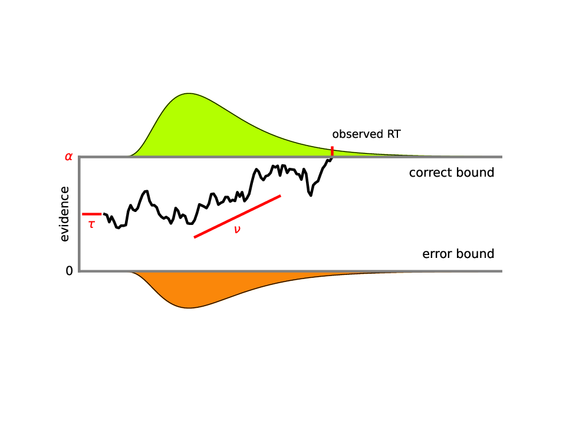
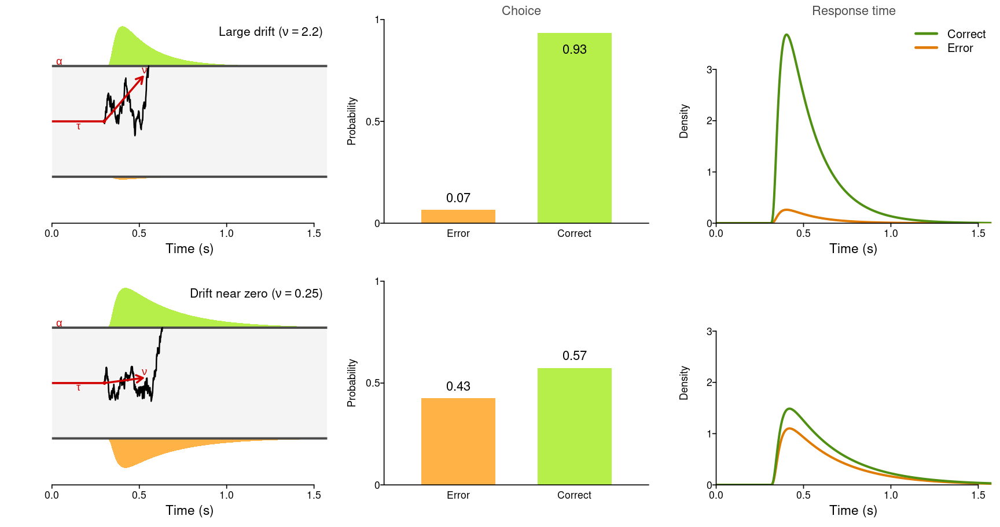
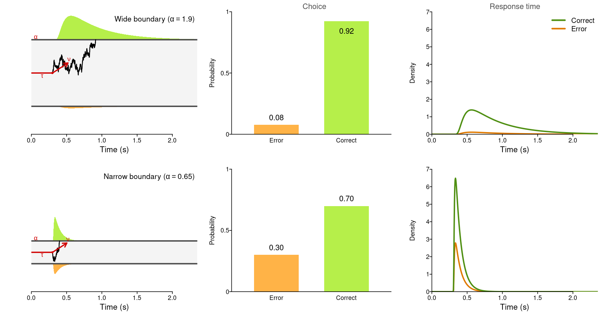
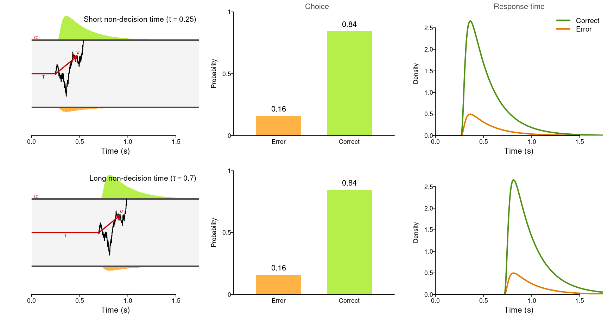

```{r}
#| label: setup
#| include: false
library(bmm)
library(brms)
library(tidyverse)
library(tidybayes)
library(knitr)
source(here::here("_common.R"))
dat <- read.csv(here::here("data", "ezddm_perceptual.csv"))
```

## Choice and RT data {.section-divider .choice-open}

Two components of any decision:

::: {.fragment}
- **What** to respond (*choice*)
- **When** are we ready to respond (*response time*)
:::

::: {.fragment}
We can model them jointly as outcomes of one evidence-accumulation process.
:::

## The drift diffusion model {.smaller}

:::: {.columns}
::: {.column width="58%"}
{fig-alt="A noisy evidence path between an error bound and a correct bound. Drift is the slope of the path, boundary separation is the gap between the bounds, and non-decision time is the delay before the path starts." width="100%"}
:::
::: {.column width="42%"}
The three-parameter model describes the evidence accumulation process from:

::: {.incremental}
- **Drift** ($\nu$). How quickly evidence accumulates toward one choice.
- **Boundary** ($\alpha$). How much evidence is required before a response.
- **Non-decision time** ($\tau$). Encoding and the motor response, before accumulation starts.
- The random walk starts at the middle of the two boundaries.
:::
:::
::::

## Drift {.smaller}

{fig-alt="Two rows for a large drift and a drift near zero. Each row shows one trial, the probability of an error and a correct response, and the response-time densities. Boundary and non-decision time are the same in both rows." width="100%"}

::: {.notes}
A large drift makes correct responses likely and fast. 
A drift near zero leaves the two choices close, and spread out. 
:::

## Boundary {.smaller}

{fig-alt="Two rows for a wide boundary and a narrow boundary. Each row shows one trial, the probability of an error and a correct response, and the response-time densities. Drift and non-decision time are the same in both rows." width="100%"}

::: {.notes}
A wide boundary is cautious: fewer errors, slower responses. 
A narrow boundary is the speed setting: faster, and less accurate.
:::

## Non-decision time {.smaller}

{fig-alt="Two rows for a short and a long non-decision time. Each row shows one trial, the probability of an error and a correct response, and the response-time densities. Drift and boundary are the same in both rows, so only the response-time location changes." width="100%"}


## What each parameter tracks {.smaller .param-vcenter}

::: {.param-map}

| Parameter |  | What it tracks |
| --- | :---: | --- |
| Drift | $\nu$ | Quality of the evidence. A clearer display raises it. In this task, a pixel configuration farther from 50/50. |
| Boundary | $\alpha$ | Caution. Accuracy instructions raise it, and speed instructions lower it. |
| Non-decision time | $\tau$ | Encoding and the motor response. It shifts when the stimulus takes longer to encode, or the response takes longer to execute. |

: {tbl-colwidths="[22,10,68]"}

:::
However, the DDM has a rather complicated likelihood function that is difficult to implement.

## The EZ equations {.smaller}

::: {.ez-stack}
Wagenmakers, van der Maas, and Grasman (2007) rewrite the model to map parameters to three summary statistics of the choice and RT data.

Let $q = \exp(-\alpha \, \nu)$.

::: {.formula-box}
$$
\begin{aligned}
\text{Proportion correct} &= \frac{1}{1 + q} \\[0.45em]
\text{Mean RT} &= \tau + \left(\frac{\alpha}{2\nu}\right)\frac{1 - q}{1 + q} \\[0.45em]
\text{Var(RT)} &= \left(\frac{\alpha}{2\nu^{3}}\right)\frac{1 - 2\alpha\nu q - q^{2}}{(1 + q)^{2}}
\end{aligned}
$$
:::

`ezdm()` fits these summaries.
:::

## The brightness task {.section-divider}

Ratcliff & Rouder (1998), Experiment 1, participant N.H.

::: {.cell-break}

| Instruction | More black | More white |
| --- | --- | --- |
| Accuracy | Conditions 1-16 | Conditions 18-33 |
| Speed | Conditions 34-49 | Conditions 51-66 |

:::

16 cells in each block, 64 in all. Conditions 17 and 50 are 50/50 black and white, and they are left out.

## Accuracy across design cells {.smaller}

```{r}
#| label: accuracy-by-xs
#| echo: false
#| fig-height: 4.8
#| fig-alt: "Accuracy in each cell against the black-to-white pixel configuration. Accuracy and speed instructions are separate colors, and each line breaks at the missing 50/50 cells."
cell_summary <- dat |>
  mutate(
    instruction = if_else(cond <= 33, "accuracy", "speed"),
    xs = ((cond - 1) %% 33 - 16) / 5,
    majority = if_else(xs < 0, "more black", "more white"),
    correct = as.integer(
      (response == 1 & majority == "more black") |
        (response == 2 & majority == "more white")
    )
  ) |>
  summarise(accuracy = mean(correct), .by = c(instruction, majority, xs))
ggplot(cell_summary, aes(xs, accuracy, color = instruction,
                          group = interaction(instruction, majority))) +
  geom_line() +
  geom_point(size = 2) +
  scale_color_manual(values = c(accuracy = wk_colors[["blue"]],
                                 speed = wk_colors[["orange"]])) +
  labs(x = "Black-to-white pixel configuration (Xs)", y = "Accuracy", color = NULL) +
  theme_workshop() +
  theme(plot.background = element_rect(fill = "white", color = NA))
```

::: {.notes}
Negative Xs is more black pixels; positive Xs is more white pixels. 
Accuracy is high at the extremes and lower near the middle, under both instructions. 
:::

## One row per cell {.smaller}

`ezdm()` reads summaries, not trials. 

```{r}
#| label: ez-model
#| code-line-numbers: "1-14|16-18"
ez_summary <- dat |>
  mutate(
    instruction = factor(if_else(cond <= 33, "accuracy", "speed"),
                         levels = c("accuracy", "speed")),
    xs = ((cond - 1) %% 33 - 16) / 5,
    abs_xs = abs(xs),
    correct = as.integer(
      (xs < 0 & response == 1) | (xs > 0 & response == 2)
    ),
    rt_s = rt_ms / 1000
  ) |>
  summarise(mean_rt = mean(rt_s), var_rt = var(rt_s),
            n_upper = sum(correct), n_trials = n(),
            .by = c(cond, instruction, abs_xs))

ez_model <- ezdm(mean_rt = "mean_rt", var_rt = "var_rt",
                 n_upper = "n_upper", n_trials = "n_trials",
                 version = "3par")
```

Mean RT and RT variance are in seconds and use every trial in the cell.

::: {.notes}
Version = "3par" of ezdm() fixes the starting point halfway between the boundaries. 
n_upper is the number of correct responses. 
:::

## One formula per parameter {.smaller .code-vcenter}

```{r}
#| label: formula
#| eval: false
#| code-line-numbers: "1-10|3|4|5"
fit_ez <- bmm(
  formula = bmf(
    drift ~ 1 + instruction + abs_xs,
    bound ~ 1 + instruction,
    ndt   ~ 1 + instruction
  ),
  data = ez_summary,
  model = ez_model,
  sample_prior = "yes"
)
```

::: {.notes}
Mention covariates of interest:
drift carries abs_xs, bound and ndt do not. 
:::

## Load the cached fit {.smaller}

```{r}
#| label: load-fit
#| code-line-numbers: "1"
fit_ez <- readRDS(here::here("models", "ezddm_summary.rds"))
fixef(fit_ez) |> round(2)
```

Boundary and non-decision time are on a log scale.

::: {.notes}
Point at drift_abs_xs (positive) and bound_instructionspeed (negative).
s is fixed, which sets the scale of drift and boundary.
:::

## Boundary and non-decision time {.smaller}

Exponentiate the log-scale draws to get the original scale.

```{r}
#| label: posterior-plot
#| echo: false
#| fig-height: 4.2
#| fig-alt: "Posterior distributions of boundary separation and non-decision time under accuracy and speed instructions."
ez_pars <- fit_ez |>
  spread_draws(b_bound_Intercept, b_bound_instructionspeed,
               b_ndt_Intercept, b_ndt_instructionspeed) |>
  mutate(
    bound_accuracy = exp(b_bound_Intercept),
    bound_speed = exp(b_bound_Intercept + b_bound_instructionspeed),
    ndt_accuracy = exp(b_ndt_Intercept),
    ndt_speed = exp(b_ndt_Intercept + b_ndt_instructionspeed)
  ) |>
  pivot_longer(c(bound_accuracy, bound_speed, ndt_accuracy, ndt_speed),
               names_to = c("parameter", "instruction"), names_sep = "_") |>
  mutate(parameter = recode(parameter,
                            bound = "Boundary separation",
                            ndt = "Non-decision time (s)"))
ggplot(ez_pars, aes(x = value, y = instruction, fill = instruction)) +
  stat_halfeye(alpha = 0.8) +
  facet_wrap(~ parameter, scales = "free_x") +
  scale_fill_manual(values = c(accuracy = wk_colors[["blue"]],
                                speed = wk_colors[["orange"]]),
                     guide = "none") +
  labs(x = NULL, y = NULL) +
  theme_workshop() +
  theme(plot.background = element_rect(fill = "white", color = NA))
```

::: {.notes}
Speed instructions pull the boundary down, as illustrated in the intro slides. 
:::

## Two questions {.q-reveal}

```{r}
#| label: tests
#| include: false
fe <- fixef(fit_ez)
q_rows <- c("drift_abs_xs", "bound_instructionspeed")
q_est <- sprintf("%.2f", fe[q_rows, "Estimate"])
q_ci <- sprintf("[%.2f, %.2f]", fe[q_rows, "Q2.5"], fe[q_rows, "Q97.5"])
bound_est <- fe["bound_instructionspeed", "Estimate"]
bound_lo <- fe["bound_instructionspeed", "Q2.5"]
bound_hi <- fe["bound_instructionspeed", "Q97.5"]
q_est_exp <- sprintf("%.2f", exp(bound_est))
q_ci_exp <- sprintf("[%.2f, %.2f]", exp(bound_lo), exp(bound_hi))
```

::: {.fragment}
**Q1:** Does drift rise as the pixel configuration moves away from 50/50?

- Estimate: `r q_est[1]`
- 95% CI: `r q_ci[1]`
:::

::: {.fragment .q-next}
**Q2:** Is the boundary lower under speed?

- Estimate: `r q_est[2]` (log) --> `r q_est_exp` (exp)
- 95% CI: `r q_ci[2]` (log) --> `r q_ci_exp` (exp)
:::


::: {.notes}
If time is short, end here. The next section is the cut.
:::

## Trial-level DDM {.trial-space}

`ddm()` reads one row per trial: (N = 7,373 trials).

```{r}
#| label: compare-fits
#| echo: false
fit_trial <- readRDS(here::here("models", "ddm_trial.rds"))
coef_names <- c("drift_abs_xs", "bound_instructionspeed", "ndt_instructionspeed")
ez_est <- fixef(fit_ez)[coef_names, "Estimate"]
trial_est <- fixef(fit_trial)[coef_names, "Estimate"]
compare_tab <- tibble(
  Coefficient = c("Drift, per unit |Xs|",
                  "Log boundary, speed - accuracy",
                  "Log non-decision, speed - accuracy"),
  EZ = sprintf("%.2f", ez_est),
  `Trial-level` = sprintf("%.2f", trial_est)
)
knitr::kable(compare_tab, align = "lcc")
```

Drift and the boundary agree in direction. The boundary shift is smaller on the trials. Non-decision time changes sign.

::: {.notes}
The Wiener likelihood uses each RT. EZ uses summary statistics. 
Agreement on drift and boundary is the point. 
:::

## Take-home {.section-divider .take-home}

:::: {.columns}
::: {.column width="64%"}
::: {.incremental}
- Drift, boundary, and non-decision time, from accuracy and the RT summaries
- The workflow you already used: `ezdm()`, one formula per parameter, then the posterior
- `examples/03_ezddm.qmd` has the analysis, including the trial-level fit
- Wagenmakers, van der Maas & Grasman (2007); Chávez De la Peña & Vandekerckhove (2025)
:::
:::
::: {.column width="36%"}
{fig-alt="QR code linking to the workshop website" width="70%"}
:::
::::

